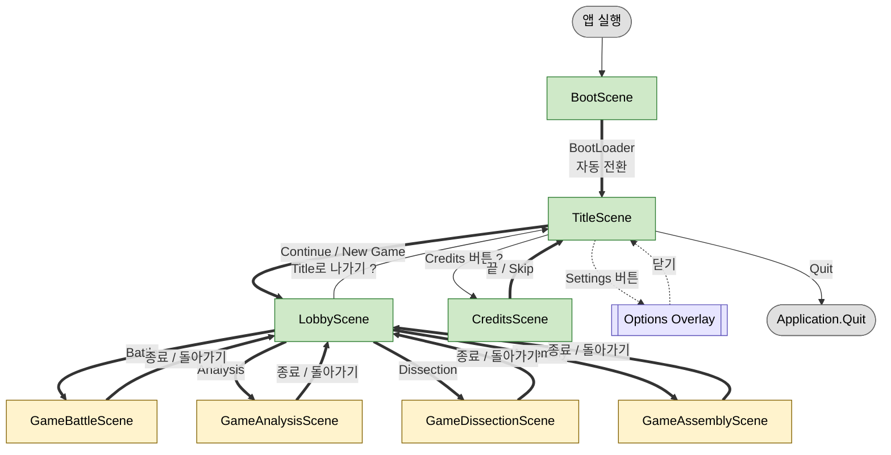
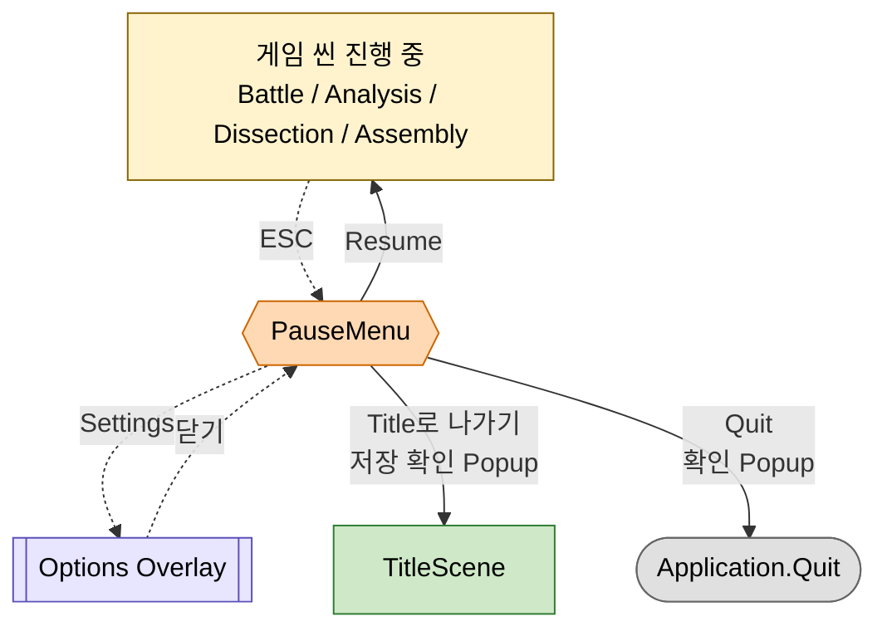

# OrganicEngineer - Scene Flow Diagram

씬 전환 흐름 순서도. (`SETUP_TODO_AND_HIERARCHY.txt`의 5) SceneFlow 순서 와 동일 내용을 그림으로 표현)

---

## 1. 전체 씬 플로우



**범례**

| 표기 | 의미 |
|------|------|
| `====>` (굵은 화살표) | 표준 동선 (확정) |
| `----->` (얇은 화살표) | 보조 동선 (UI 결정 필요 — `?` 표시) |
| `-..->` (점선)         | 씬 전환이 아닌 오버레이 호출/닫기 |
| 초록 박스 | 인프라 씬 (Boot/Title/Lobby/Credits) — 골격 완료 |
| 노랑 박스 | 게임 씬 — 시스템 기획 대기 |
| 보라 박스 | 오버레이 (씬 전환 없음) |
| 회색 박스 | 종단점 (시작/종료) |

---

## 2. 게임 씬 일시정지 흐름 (D-5 PauseMenu)



> ESC 키 우선순위: 옵션 화면이 떠있을 땐 옵션 닫기, 그 다음 PauseMenu 토글 (모달 스택 D-1).

---

## 3. 표준 호출 패턴

모든 씬 전환은 다음 두 줄로 통일된다:

```csharp
GameRoot.Instance.SceneFlow.NextScene(targetSceneListConfig);
GameRoot.Instance.SceneFlow.Load();
```

| 트리거 | 호출 |
|--------|------|
| `Title.ContinueButton` (D-4 + D-8) | `NextScene(LobbyScene) → Load()` |
| `Title.NewGameButton` (D-4 + D-1 Popup) | `NextScene(LobbyScene) → Load()` |
| `Title.CreditsButton` (`?`) | `NextScene(CreditsScene) → Load()` |
| `Title.SettingsButton` (D-4) | `Options.Open()` (씬 전환 없음) |
| `Title.QuitButton` (D-4 + D-1 Popup) | `Application.Quit()` |
| `Lobby.BattleButton`     | `NextScene(GameBattleScene) → Load()` |
| `Lobby.AnalysisButton`   | `NextScene(GameAnalysisScene) → Load()` |
| `Lobby.DissectionButton` | `NextScene(GameDissectionScene) → Load()` |
| `Lobby.AssemblyButton`   | `NextScene(GameAssemblyScene) → Load()` |
| `Lobby.BackToTitleButton` (`?`) | `NextScene(TitleScene) → Load()` |
| 게임 씬 종료 / Pause→Title | `NextScene(LobbyScene 또는 TitleScene) → Load()` |
| Credits 종료 / Skip | `NextScene(TitleScene) → Load()` |

> 예외: `BootScene` 진입 직후 `BootLoader`는 `SceneManager.LoadScene`을 직접 호출
> (페이드 효과가 의미 없는 부팅 시점이라 의도적). 추후 통일 패턴 적용 여부는 `?`.

---

## 4. 미정 사항 (시스템 기획 결정 필요)

- [ ] Title에 Credits 진입 버튼을 노출할지
- [ ] 게임 씬 종료 시 결과 화면(전투 결과/통계)을 거칠지, 즉시 Lobby로 복귀할지
- [ ] Lobby에서 Title로 나가는 동선 노출 여부 (작업 이탈 정책)
- [ ] BootLoader의 첫 전환을 SceneFlow.NextScene + Load 통일 패턴으로 바꿀지

> 결정되면 본 문서와 `SETUP_TODO_AND_HIERARCHY.txt`의 5)/[?] 항목을 동시에 갱신할 것.
